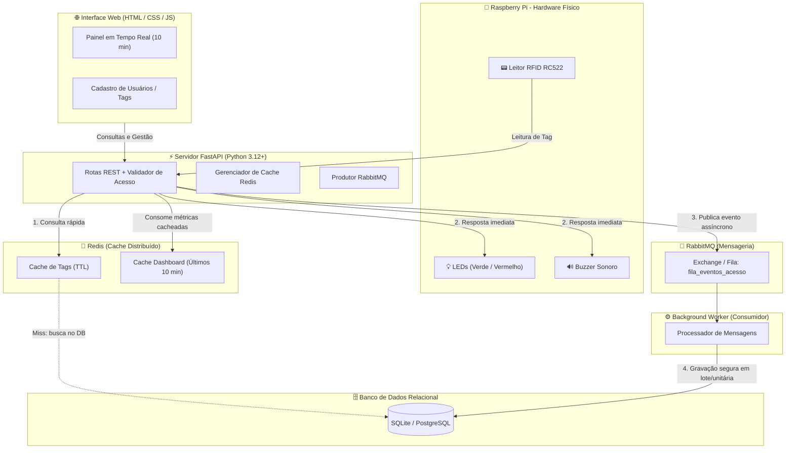

# 📄 PRD (Product Requirements Document) — Controle de Acesso Distribuído v2 (FastAPI + Redis + RabbitMQ + Raspberry Pi Hardware)

## 1. Visão Geral do Produto
- **Nome da Demanda:** `controle-acesso-v2-distribuido`
- **Contexto de Negócio / Acadêmico:** Trabalho acadêmico integrador de Engenharia / Ciência da Computação para controle de acesso físico a laboratório via cartão RFID, executado em uma Raspberry Pi como servidor/hardware integrado.
- **Objetivo Principal (O Quê):** Desenvolver um sistema completo e distribuído de controle de acesso composto por:
  1. **Servidor API REST em FastAPI:** Cadastro de usuários/colaboradores, consulta de histórico, validação e alimentação do dashboard.
  2. **Cache Distribuído com Redis:**
     - Estratégia *Cache-Aside* para validação rápida de tags RFID na catraca/porta.
     - Cache de métricas do dashboard dos últimos 10 minutos para não onerar o banco de dados.
  3. **Mensageria com RabbitMQ:**
     - Publicação assíncrona dos eventos de leitura de cartão para a fila.
     - Consumidor dedicado (*worker*) que processa as mensagens da fila e persiste o histórico no banco de dados sem adicionar latência à resposta da porta.
  4. **Integração com Hardware Físico na Raspberry Pi:**
     - Leitor RFID RC522 (via SPI).
     - Sinalização visual com LEDs (Verde para Liberado, Vermelho para Negado/Invasão).
     - Sinalização sonora com Buzzer (bipes diferenciados de sucesso e erro).
     - Modo de simulação/mock compatível com Windows/Linux para testes e desenvolvimento sem a placa física.
  5. **Painel Web (HTML/CSS/JS):**
     - Dashboard em tempo real consumindo os dados em cache do Redis e permitindo simulações e cadastros.
- **Justificativa de Negócio / Requisitos:** Atender 100% aos requisitos da disciplina: Python com FastAPI, Redis como cache distribuído, RabbitMQ como mensageria, Raspberry Pi como servidor exposto na rede com hardware físico acoplado e separação estrita entre Servidor e Cliente.

---

## 2. Personas e Arquitetura de Alto Nível

---

## 3. Requisitos Funcionais (RF)

### Módulo 1: Servidor API REST (FastAPI)
- **RF01 — Cadastro e Gestão de Usuários/Colaboradores:**
  - Endpoints REST para criar, listar, atualizar e desativar usuários e seus respectivos UIDs de cartão RFID.
  - Ao atualizar ou desativar um usuário, invalidar ou atualizar a chave correspondente no Redis.
- **RF02 — Validação de Acesso (`POST /api/validar`):**
  - Recebe o UID lido pelo leitor RFID.
  - Verifica autorização no Redis (Cache-Aside).
  - Emite decisão (`ENTRADA`, `SAIDA`, `NEGADO`, `INVASAO`).
  - Publica a mensagem de evento no RabbitMQ de forma não bloqueante.
  - Retorna a resposta imediatamente para acionar os atuadores da porta.
- **RF03 — Histórico e Dashboard dos Últimos 10 Minutos:**
  - Endpoint `GET /api/dashboard/10min`: retorna estatísticas agregadas (total de acessos, liberados, negados, lista de últimos eventos) armazenadas no Redis com expiração/atualização a cada poucos segundos.
  - Endpoint `GET /api/historico`: consulta diretamente o banco de dados com filtros opcionais.

### Módulo 2: Cache Distribuído (Redis)
- **RF04 — Cache-Aside de Autorização de Cartões:**
  - Chave: `rfid:tag:{uid}` com dados do usuário e status de permissão.
  - TTL configurável (ex: 300 segundos).
  - Em caso de *hit*, valida instantaneamente em sub-milissegundos.
  - Em caso de *miss*, busca no SQLite, armazena no Redis e responde.
- **RF05 — Cache de Agregações do Dashboard (Últimos 10 Minutos):**
  - Chave: `rfid:dashboard:10min`.
  - Atualizado periodicamente ou na leitura para aliviar o banco relacional.

### Módulo 3: Mensageria Assíncrona (RabbitMQ)
- **RF06 — Publicador de Eventos de Acesso:**
  - Publicação de mensagens JSON contendo: `tag_uid`, `timestamp`, `resultado`, `usuario_id`, `nome`.
  - Publicação rápida e resiliente com confirmação básica.
- **RF07 — Consumidor / Worker em Background:**
  - Processo independente que consome da fila `eventos_acesso`.
  - Persiste o evento no banco de dados SQLite/PostgreSQL com tratamento de falhas e reconexão automática.

### Módulo 4: Hardware Físico na Raspberry Pi
- **RF08 — Leitura Contínua RFID (RC522):**
  - Leitura via barramento SPI (`spidev` / `mfrc522`).
- **RF09 — Sinalização Visual (LEDs):**
  - LED Verde: acende por 2 segundos ao liberar o acesso.
  - LED Vermelho: pisca por 2 segundos ao negar o acesso ou em invasão.
- **RF10 — Sinalização Sonora (Buzzer):**
  - Bipe curto e suave ao liberar o acesso.
  - Sequência de bipes rápidos de alerta ao negar ou detectar invasão.
- **RF11 — Abstração de Hardware (Driver Mock):**
  - Camada de injeção que detecta se está rodando em uma Raspberry Pi real (GPIO presente) ou em ambiente de desenvolvimento (Windows/Linux PC), permitindo simular leituras via console ou API.

### Módulo 5: Cliente Web (HTML/CSS/JS)
- **RF12 — Dashboard em Tempo Real:**
  - Exibição de cards com contadores dos últimos 10 minutos.
  - Feed ao vivo dos acessos.
  - Formulário para simulação rápida de leitura de cartão.

---

## 4. Requisitos Não-Funcionais (RNF)

- **RNF01 — Latência de Resposta da Porta:** A resposta de liberação/bloqueio com acionamento dos LEDs/Buzzer deve ocorrer em **menos de 150ms** graças ao cache do Redis e à gravação assíncrona no RabbitMQ.
- **RNF02 — Arquitetura Limpa e Modular:** Código desacoplado em pacotes `server`, `worker`, `hardware` e `client`.
- **RNF03 — Infraestrutura de Apoio (Docker Compose):** Disponibilizar arquivo `docker-compose.yml` para inicialização imediata do Redis e do RabbitMQ.
- **RNF04 — Facilidade de Avaliação:** Documentação completa no `README.md` explicando a execução na Raspberry Pi e no ambiente de desenvolvimento local.

