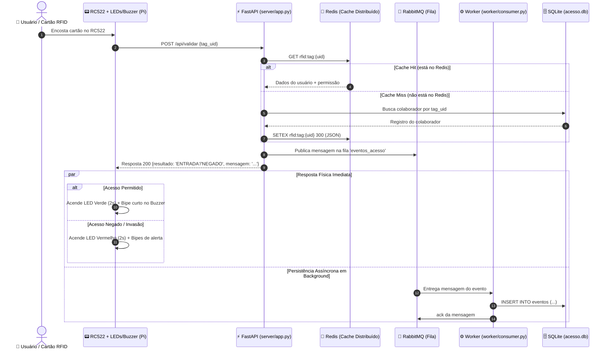

# 🛠️ Tech Spec (Especificação Técnica) — Controle de Acesso Distribuído v2

## 1. Visão Geral da Arquitetura

O sistema é dividido em 4 camadas bem delimitadas:
1. **Hardware / Embarcado (Raspberry Pi):** Leitura de cartões via RC522 (SPI) e atuadores (LEDs e Buzzer via GPIO).
2. **Servidor API REST (FastAPI):** Lógica de validação em memória/cache, controle de usuários e endpoints REST.
3. **Camada de Dados & Mensageria:**
   - **Redis:** Cache de autorização (Cache-Aside) e cache de agregados do Dashboard (últimos 10 min).
   - **RabbitMQ:** Fila `eventos_acesso` para descarregar o histórico assincronamente.
   - **SQLite:** Banco de dados relacional para persistência de longo prazo.
4. **Worker Consumidor (Python):** Processo que drena a fila do RabbitMQ e faz os inserts no SQLite.



---

## 2. Modelagem de Dados

### 2.1 Esquema do SQLite (`acesso.db`)
```sql
CREATE TABLE IF NOT EXISTS colaboradores (
    id INTEGER PRIMARY KEY AUTOINCREMENT,
    nome TEXT NOT NULL,
    matricula TEXT NOT NULL UNIQUE,
    tag_uid TEXT NOT NULL UNIQUE,
    cargo TEXT NOT NULL,
    acesso_sala INTEGER NOT NULL DEFAULT 1,
    ativo INTEGER NOT NULL DEFAULT 1,
    criado_em TEXT DEFAULT CURRENT_TIMESTAMP
);

CREATE TABLE IF NOT EXISTS eventos (
    id INTEGER PRIMARY KEY AUTOINCREMENT,
    data_hora TEXT NOT NULL,
    tag_uid TEXT NOT NULL,
    nome TEXT NOT NULL,
    resultado TEXT NOT NULL CHECK(resultado IN ('ENTRADA', 'SAIDA', 'NEGADO', 'INVASAO')),
    sincronizado_em TEXT DEFAULT CURRENT_TIMESTAMP
);

CREATE INDEX IF NOT EXISTS idx_colab_tag ON colaboradores(tag_uid);
CREATE INDEX IF NOT EXISTS idx_eventos_data ON eventos(data_hora);
```

### 2.2 Estrutura de Chaves no Redis

| Chave | Tipo | TTL | Descrição |
| :--- | :--- | :--- | :--- |
| `rfid:tag:{uid}` | `String` (JSON) | 300 s (5 min) | Armazena dados cadastrais e permissão: `{"nome": "Ana", "acesso_sala": true, "ativo": true}`. Em alteração cadastral, a chave é deletada/invalidada. |
| `rfid:dashboard:10min` | `String` (JSON) | 10 s | Contém estatísticas consolidadas dos últimos 10 min: contagem de entradas, saídas, negados, invasões e lista dos últimos 10 acessos. |
| `rfid:na_sala:{matricula}` | `String` | 86400 s | Armazena o estado atual (`ENTROU` / `SAIU`) para alternar entre ENTRADA e SAIDA na porta do laboratório. |

### 2.3 Topologia do RabbitMQ

- **Fila:** `eventos_acesso`
- **Exchange:** `amq.direct` (ou default exchange `""` com routing key `eventos_acesso`)
- **Durable:** `True` (garante que mensagens não se perdem se o RabbitMQ reiniciar)
- **Estrutura do Payload (JSON):**
```json
{
  "timestamp": "2026-11-09T21:40:00",
  "tag_uid": "A1B2C3D4",
  "nome": "Ana",
  "resultado": "ENTRADA"
}
```

---

## 3. Contratos de API REST (FastAPI)

| Método | Endpoint | Descrição | Origem |
| :--- | :--- | :--- | :--- |
| `POST` | `/api/validar` | Recebe `{"tag_uid": "..."}`. Consulta Redis $\rightarrow$ DB, despacha para RabbitMQ e retorna `{resultado, mensagem}`. | Hardware (RC522) / Simulador |
| `GET` | `/api/colaboradores` | Lista colaboradores cadastrados. | Front-end |
| `POST` | `/api/colaboradores` | Cadastra novo colaborador (invalida cache da tag no Redis). | Front-end |
| `PUT` | `/api/colaboradores/{id}` | Edita colaborador e permissões (invalida cache). | Front-end |
| `DELETE` | `/api/colaboradores/{id}` | Remove colaborador (deleta cache do Redis). | Front-end |
| `GET` | `/api/dashboard/10min` | Retorna métricas dos últimos 10 minutos cacheadas no Redis. | Front-end |
| `GET` | `/api/historico` | Consulta histórico completo paginado diretamente no banco SQLite. | Front-end / Relatórios |
| `GET` | `/api/eventos.csv` | Exporta arquivo CSV de histórico. | Pandas / Auditoria |

---

## 4. Arquitetura de Hardware e Mapeamento GPIO

### 4.1 Pinout Recomendado na Raspberry Pi (Modelo 3B+ / 4B)

```
        Raspberry Pi 40-Pin Header
           3V3 Power [ 1] [ 2] 5V Power
   RC522 SDA (GPIO8) [24] [ 6] Ground
  RC522 SCK (GPIO11) [23] [ 7]
 RC522 MOSI (GPIO10) [19] [11] LED Verde (GPIO17)
  RC522 MISO (GPIO9) [21] [13] LED Vermelho (GPIO27)
   RC522 RST (GPIO25)[22] [15] Buzzer Ativo (GPIO22)
              Ground [20] [14] Ground
```

### 4.2 Abstração de Hardware (`hardware/rfid_driver.py`)
- Classe `HardwareController`:
  - Se `GPIO` e `spidev` estiverem disponíveis (Raspberry Pi real): opera pinos físicos e lê MFRC522.
  - Se não estiverem disponíveis (PC de Desenvolvimento / Windows / CI): ativa o `MockHardwareController`, que loga em cores no console e permite injetar tags simuladas via teclado ou chamada de função sem falhar.

---

## 5. Estrutura de Diretórios Proposta

```
controle-acesso-rfid/
├── docker-compose.yml          # Sobe Redis e RabbitMQ com 1 comando
├── requirements.txt            # Dependências (fastapi, uvicorn, redis, pika, etc.)
├── server/
│   ├── __init__.py
│   ├── app.py                  # Aplicação FastAPI principal
│   ├── config.py               # Configurações de ambiente (URLs do Redis/RabbitMQ, etc.)
│   ├── database.py             # Repositório SQLite
│   ├── models.py               # Modelos Pydantic e Dataclasses
│   ├── services.py             # Lógica de negócio de acesso
│   ├── redis_client.py         # Módulo de integração e cache-aside do Redis
│   └── rabbit_producer.py      # Produtor de mensagens do RabbitMQ
├── worker/
│   ├── __init__.py
│   └── consumer.py             # Consumidor RabbitMQ que grava eventos no banco
├── hardware/
│   ├── __init__.py
│   ├── rfid_reader.py          # Leitura do RC522 + controle de LEDs e Buzzer
│   └── mock_reader.py          # Simulador de hardware para rodar em PC
├── client/                     # Interface Web (HTML, CSS, JS)
│   ├── static/
│   │   ├── css/styles.css
│   │   └── js/
│   │       ├── api.js
│   │       ├── monitor.js      # Consome dashboard/10min
│   │       └── colaboradores.js
│   └── templates/
│       ├── login.html
│       ├── monitor.html
│       └── colaboradores.html
└── tests/
    ├── test_api.py             # Testes das rotas FastAPI
    ├── test_redis_cache.py     # Testes do Cache-Aside
    └── test_worker.py          # Testes do consumidor RabbitMQ
```

