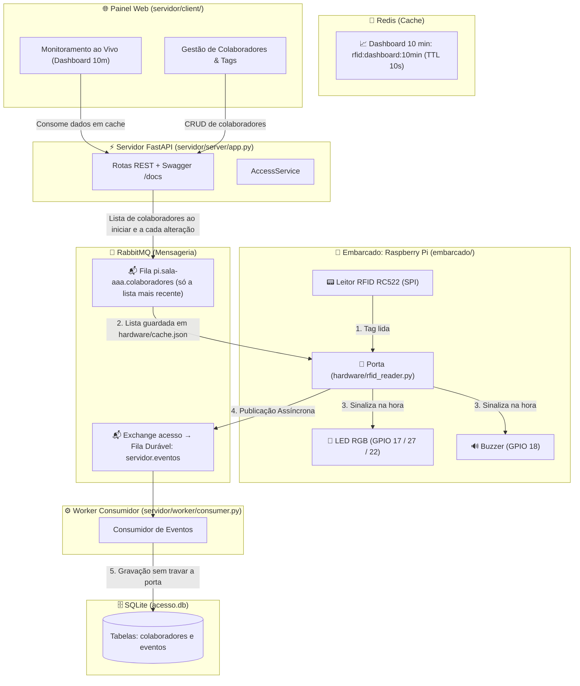

# 🛡️ Sistema Distribuído de Controle de Acesso RFID & Monitoramento

Sistema desenvolvido em **Python 3.12+ (FastAPI)** integrado a **Cache Distribuído (Redis)**, **Mensageria Assíncrona (RabbitMQ)**, persistência relacional (**SQLite**) e **Hardware Físico na Raspberry Pi** (Leitor RFID RC522, LEDs de sinalização e Buzzer sonoro), além de **Painel Web em Tempo Real** (HTML5 / CSS3 / JavaScript moderno).

---

## 🏗️ 1. Arquitetura do Sistema



### Estrutura do repositório

O sistema é dividido em duas partes independentes, que só se comunicam pelo **RabbitMQ**, pela rede:

```
controle-acesso-rfid/
├── servidor/              # roda no computador servidor
│   ├── server/            # API FastAPI, SQLite, Redis, produtor RabbitMQ
│   ├── worker/            # consome os eventos da Pi e grava no SQLite
│   ├── client/            # painel web
│   ├── tests/
│   ├── docker-compose.yml # sobe Redis e RabbitMQ
│   ├── requirements.txt
│   └── main.py            # sobe API + worker
│
├── embarcado/             # roda na Raspberry Pi
│   ├── hardware/          # rfid_reader (porta), leitor (RC522), atuadores (LED e buzzer), config
│   ├── tests/
│   └── requirements.txt
│
└── docs/                  # documentação histórica (planejamento e versões v1/v2)
```

| Fila | Sentido | Conteúdo |
| :--- | :--- | :--- |
| `pi.<dispositivo>.colaboradores` | servidor → Pi | Lista completa de colaboradores (só a mais recente) |
| `servidor.eventos` | Pi → servidor | Cada leitura de cartão (`ENTRADA`, `SAIDA`, `NEGADO`, `INVASAO`) |

O nome da exchange (`acesso`), os nomes das filas e o formato das mensagens estão escritos nos dois lados (`servidor/server/config.py` e `embarcado/hardware/config.py`). Ao mudar um, mude o outro.

---

## 🔌 2. Pinout do Hardware na Raspberry Pi

O RC522 funciona em **3.3 V**. Os pinos ficam em [`embarcado/hardware/config.py`](embarcado/hardware/config.py).

| Componente | Pino do Componente | Pino Físico Raspberry Pi | GPIO (BCM) |
| :--- | :--- | :--- | :--- |
| **RC522** | SDA | Pino 24 | GPIO 8 (CE0) |
| **RC522** | SCK | Pino 23 | GPIO 11 (SCLK) |
| **RC522** | MOSI | Pino 19 | GPIO 10 (MOSI) |
| **RC522** | MISO | Pino 21 | GPIO 9 (MISO) |
| **RC522** | RST | Pino 22 | GPIO 25 |
| **RC522** | GND | Pino 6 | Ground |
| **RC522** | 3.3V | Pino 1 | 3V3 Power |
| **LED RGB** | Vermelho | Pino 11 | **GPIO 17** (resistor 220 Ω) |
| **LED RGB** | Verde | Pino 13 | **GPIO 27** (resistor 220 Ω) |
| **LED RGB** | Azul | Pino 15 | **GPIO 22** (resistor 220 Ω) |
| **LED RGB** | Comum | Pino 9 (GND) se cátodo · Pino 17 (3.3V) se ânodo | — |
| **Buzzer Ativo** | + | Pino 12 | **GPIO 18** |
| **Buzzer Ativo** | − | Pino 14 | Ground |

Se o LED for de ânodo comum, mude `LED_ANODO_COMUM` para `True`.

### Sinalização

| Resultado | LED | Buzzer |
| :--- | :--- | :--- |
| `ENTRADA` | Verde por 2 s | 1 bip curto |
| `SAIDA` | Amarelo por 2 s | 2 bips curtos |
| `NEGADO` | Amarelo por 2 s | 1 bip longo |
| `INVASAO` | Vermelho piscando 3× | 3 bips curtos |

O mesmo cartão é ignorado por 3 s (`DEBOUNCE_SEGUNDOS`), para não ler duas vezes.

---

## 🚀 3. Como Executar

### Servidor

```bash
cd servidor
python3 -m venv venv && source venv/bin/activate
pip install -r requirements.txt
python main.py
```

O `main.py` sobe o Redis e o RabbitMQ pelo Docker (se disponível), a API na porta `5000` e o worker. Sem Docker, instale `redis-server` e `rabbitmq-server` pelo `apt`. `Ctrl+C` encerra tudo.

Ou um terminal para cada, de dentro de `servidor/`:

```bash
python -m uvicorn server.app:app --host 0.0.0.0 --port 5000   # API + painel web
python -m worker.consumer                                     # RabbitMQ -> SQLite
```

### Embarcado (Raspberry Pi)

```bash
sudo raspi-config nonint do_spi 0          # habilita o SPI (reinicie depois)
cd embarcado
python3 -m venv --system-site-packages venv && source venv/bin/activate
pip install -r requirements.txt mfrc522
python -m hardware.rfid_reader
```

`--system-site-packages` aproveita o `gpiozero` e o `RPi.GPIO` que já vêm no Raspberry Pi OS. A Pi não precisa de Redis, RabbitMQ nem do código do servidor.

`python -m hardware.leitor` mostra o UID de cada cartão (cadastre a tag exatamente como aparece) e `python -m hardware.atuadores` testa as quatro sinalizações.

Fora da Raspberry, o mesmo comando abre o **simulador**: você digita a tag no terminal e o LED e o buzzer viram texto. Com o servidor na mesma máquina, não é preciso mudar nada no `config.py`.

### Conectando pela rede

O usuário `guest` do RabbitMQ só funciona em conexões locais. No servidor, crie um usuário para a Pi e libere a porta `5672` no firewall:

```bash
sudo rabbitmqctl add_user pi <senha>
sudo rabbitmqctl set_permissions -p / pi ".*" ".*" ".*"
```

Na Pi, edite [`embarcado/hardware/config.py`](embarcado/hardware/config.py): `RABBITMQ_HOST` com o IP do servidor, `RABBITMQ_USER` e `RABBITMQ_PASS` com o usuário criado acima. `DISPOSITIVO` (padrão `sala-aaa`) precisa ser o mesmo do servidor.

> Servidor rodando no WSL2: a Pi não alcança a rede interna do WSL. Ative `networkingMode=mirrored` no `.wslconfig` ou encaminhe a porta com `netsh interface portproxy`.

Sem conexão com o RabbitMQ, a Pi continua decidindo com o `cache.json` e guarda os eventos em `pendentes.jsonl`. Uma thread tenta reenviá-los a cada 15 s (`REENVIO_PENDENTES_SEGUNDOS`), sem depender de uma nova leitura. Se ela nunca recebeu a lista, todo cartão é `INVASAO`.

O servidor publica a lista de colaboradores ao iniciar, a cada alteração no painel e, por garantia, a cada 60 s (`REPUBLICAR_LISTA_SEGUNDOS`). Assim, uma Pi que liga sem `cache.json` recebe a lista em até 1 minuto. A Pi ignora uma lista igual à que já tem, sem regravar o arquivo.

No servidor, se a gravação no banco falhar (banco travado, schema antigo), o worker devolve o evento à fila e tenta de novo; só descarta mensagens inválidas.

Os arquivos `cache.json`, `estado.json` e `pendentes.jsonl` são dados locais da Pi e ficam fora do git. Num clone novo, a Pi começa sem ninguém na sala e recebe a lista do servidor ao conectar.

---

## 🧪 4. Como Executar os Testes Automatizados

```bash
cd servidor && python -m unittest tests.test_server -v
cd embarcado && python -m unittest tests.test_embarcado -v
```

---

## 📜 5. Resumo das Rotas da API REST (`/docs`)

A validação do cartão não é uma rota: acontece dentro da porta (`embarcado/hardware/rfid_reader.py`). A Pi não acessa o banco nem o Redis do servidor: recebe a lista de colaboradores pela fila `pi.<dispositivo>.colaboradores`, guarda em `embarcado/hardware/cache.json`, decide sozinha e publica o evento no RabbitMQ. Enquanto nunca tiver recebido a lista, todo cartão é `INVASAO`.

| Método | Rota | Descrição |
| :--- | :--- | :--- |
| `POST` | `/login` | Autentica o administrador do sistema. |
| `GET` | `/api/dashboard/10min` | Retorna métricas dos últimos 10 minutos cacheadas no Redis. |
| `GET` | `/api/colaboradores` | Lista colaboradores com permissões e estado do dia. |
| `POST` | `/api/colaboradores` | Cadastra novo colaborador e tag (publica a lista nova para a Pi). |
| `PUT` | `/api/colaboradores/{id}` | Edita permissões e crachá do colaborador (publica a lista nova para a Pi). |
| `DELETE`| `/api/colaboradores/{id}` | Remove colaborador do sistema. |
| `GET` | `/api/eventos` | Lista registros de acesso filtrados por data ou completos. |
| `GET` | `/api/eventos.csv` | Exporta relatório consolidado para análise no Pandas (`Analise1.ipynb`). |
