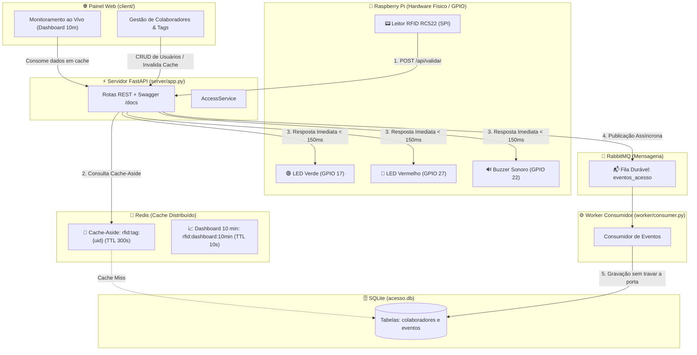

# 🛡️ Sistema Distribuído de Controle de Acesso RFID & Monitoramento

Sistema desenvolvido em **Python 3.12+ (FastAPI)** integrado a **Cache Distribuído (Redis)**, **Mensageria Assíncrona (RabbitMQ)**, persistência relacional (**SQLite**) e **Hardware Físico na Raspberry Pi** (Leitor RFID RC522, LEDs de sinalização e Buzzer sonoro), além de **Painel Web em Tempo Real** (HTML5 / CSS3 / JavaScript moderno).

---

## 🏗️ 1. Arquitetura do Sistema



---

## 🔌 2. Pinout do Hardware na Raspberry Pi

Conexões recomendadas nos pinos GPIO da Raspberry Pi (Modelo 3B+ / 4B):

| Componente | Pino do Componente | Pino Físico Raspberry Pi | GPIO (BCM) |
| :--- | :--- | :--- | :--- |
| **RC522 (SDA / SS)** | SDA | Pino 24 | GPIO 8 (CE0) |
| **RC522 (SCK)** | SCK | Pino 23 | GPIO 11 (SCLK) |
| **RC522 (MOSI)** | MOSI | Pino 19 | GPIO 10 (MOSI) |
| **RC522 (MISO)** | MISO | Pino 21 | GPIO 9 (MISO) |
| **RC522 (RST)** | RST | Pino 22 | GPIO 25 |
| **RC522 (GND)** | GND | Pino 6 ou 20 | Ground |
| **RC522 (3.3V)** | 3.3V | Pino 1 | 3V3 Power |
| **LED Verde** | Ânodo (+) | Pino 11 | **GPIO 17** (com resistor 220Ω / 330Ω) |
| **LED Vermelho** | Ânodo (+) | Pino 13 | **GPIO 27** (com resistor 220Ω / 330Ω) |
| **Buzzer Ativo** | VCC (+) | Pino 15 | **GPIO 22** |
| **LEDs / Buzzer** | Cátodo (-) | Pino 14 | Ground |

---

## 🚀 3. Como Executar o Projeto com Um Único Comando

Você pode iniciar **todos os serviços de uma só vez** executando o script [`main.py`](file:///c:/Users/Gui/Desktop/controle-acesso-rfid/main.py):

```powershell
python main.py
```

### O que o `main.py` faz automaticamente:
1. 🐳 **Sobe os contêineres Docker** de **Redis** e **RabbitMQ** (se o Docker estiver disponível na máquina).
2. ⚡ **Inicia o Servidor FastAPI** (porta `5000` em background).
3. 🐇 **Inicia o Worker Consumidor do RabbitMQ** em background para persistência assíncrona.
4. 📟 **Inicia o Leitor RFID**:
   - **Na Raspberry Pi:** Conecta diretamente ao leitor físico RC522 e aos LEDs/Buzzer.
   - **No Computador de Desenvolvimento:** Ativa o simulador no terminal, permitindo digitar tags (ex: `A1B2C3D4`, `B2C3D4E5`, `FF998877`) e ver a liberação/bloqueio em tempo real.
5. 🛑 **Encerramento Unificado:** Ao pressionar `Ctrl+C` ou digitar `sair`, ele encerra todos os processos limpos simultaneamente.

---

### Execução Individual dos Módulos (Opcional)

---

## 🧪 4. Como Executar os Testes Automatizados

Para rodar a suíte completa de testes unitários e de integração:
```bash
python -m unittest tests.test_server -v
```

---

## 📜 5. Resumo das Rotas da API REST (`/docs`)

| Método | Rota | Descrição |
| :--- | :--- | :--- |
| `POST` | `/login` | Autentica o administrador do sistema. |
| `POST` | `/api/validar` | Valida tag RFID (Cache-Aside no Redis $\rightarrow$ SQLite) e publica no RabbitMQ. |
| `GET` | `/api/dashboard/10min` | Retorna métricas dos últimos 10 minutos cacheadas no Redis. |
| `GET` | `/api/colaboradores` | Lista colaboradores com permissões e estado do dia. |
| `POST` | `/api/colaboradores` | Cadastra novo colaborador e tag (invalida cache). |
| `PUT` | `/api/colaboradores/{id}` | Edita permissões e crachá do colaborador (invalida cache). |
| `DELETE`| `/api/colaboradores/{id}` | Remove colaborador do sistema. |
| `GET` | `/api/eventos` | Lista registros de acesso filtrados por data ou completos. |
| `GET` | `/api/eventos.csv` | Exporta relatório consolidado para análise no Pandas (`Analise1.ipynb`). |
