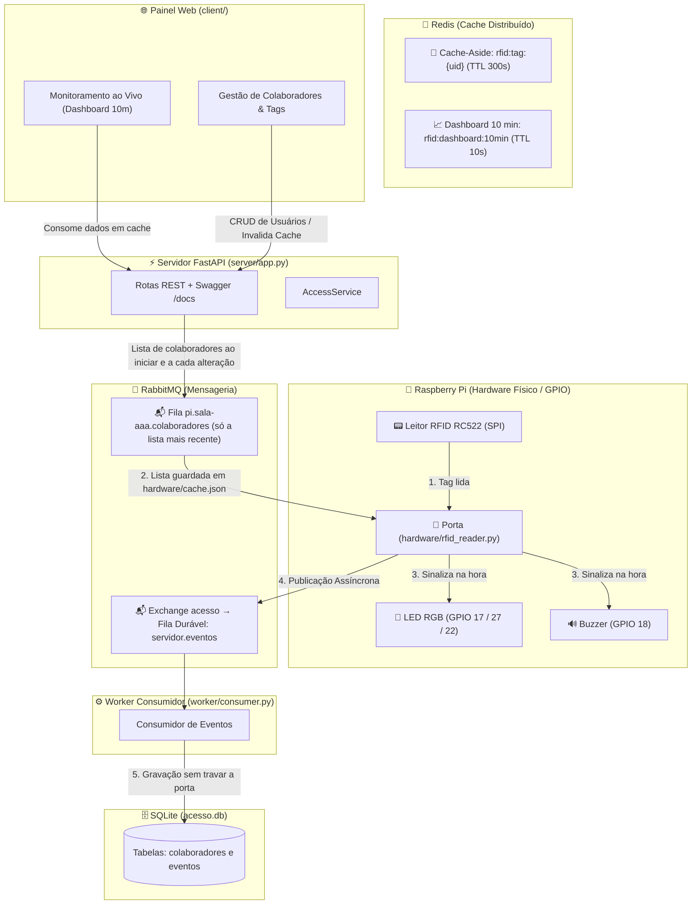

# 🛡️ Sistema Distribuído de Controle de Acesso RFID & Monitoramento

Sistema desenvolvido em **Python 3.12+ (FastAPI)** integrado a **Cache Distribuído (Redis)**, **Mensageria Assíncrona (RabbitMQ)**, persistência relacional (**SQLite**) e **Hardware Físico na Raspberry Pi** (Leitor RFID RC522, LEDs de sinalização e Buzzer sonoro), além de **Painel Web em Tempo Real** (HTML5 / CSS3 / JavaScript moderno).

---

## 🏗️ 1. Arquitetura do Sistema



---

## 🔌 2. Pinout do Hardware na Raspberry Pi

O RC522 funciona em **3.3 V**. Os pinos ficam em [`hardware/config.py`](hardware/config.py).

| Componente | Pino do Componente | Pino Físico Raspberry Pi | GPIO (BCM) |
| :--- | :--- | :--- | :--- |
| **RC522** | SDA | Pino 24 | GPIO 8 (CE0) |
| **RC522** | SCK | Pino 23 | GPIO 11 (SCLK) |
| **RC522** | MOSI | Pino 19 | GPIO 10 (MOSI) |
| **RC522** | MISO | Pino 21 | GPIO 9 (MISO) |
| **RC522** | RST | Pino 22 | GPIO 25 |
| **RC522** | GND | Pino 6 | Ground |
| **RC522** | 3.3V | Pino 1 | 3V3 Power |
| **LED RGB** | Vermelho | Pino 11 | **GPIO 17** (resistor 220 Ω) |
| **LED RGB** | Verde | Pino 13 | **GPIO 27** (resistor 220 Ω) |
| **LED RGB** | Azul | Pino 15 | **GPIO 22** (resistor 220 Ω) |
| **LED RGB** | Comum | Pino 9 (GND) se cátodo · Pino 17 (3.3V) se ânodo | — |
| **Buzzer Ativo** | + | Pino 12 | **GPIO 18** |
| **Buzzer Ativo** | − | Pino 14 | Ground |

Se o LED for de ânodo comum, mude `LED_ANODO_COMUM` para `True`.

### Sinalização

| Resultado | LED | Buzzer |
| :--- | :--- | :--- |
| `ENTRADA` | Verde por 2 s | 1 bip curto |
| `SAIDA` | Amarelo por 2 s | 2 bips curtos |
| `NEGADO` | Amarelo por 2 s | 1 bip longo |
| `INVASAO` | Vermelho piscando 3× | 3 bips curtos |

O mesmo cartão é ignorado por 3 s (`DEBOUNCE_SEGUNDOS`), para não ler duas vezes.

### Instalação na Raspberry Pi

```bash
sudo raspi-config nonint do_spi 0          # habilita o SPI (reinicie depois)
sudo apt install redis-server rabbitmq-server
python3 -m venv --system-site-packages venv
source venv/bin/activate
pip install -r requirements.txt mfrc522
python main.py
```

`--system-site-packages` aproveita o `gpiozero` e o `RPi.GPIO` que já vêm no Raspberry Pi OS. Com Redis e RabbitMQ instalados pelo `apt`, o Docker não é necessário.

---

## 🚀 3. Como Executar o Projeto com Um Único Comando

Você pode iniciar **todos os serviços de uma só vez** executando o script [`main.py`](main.py):

```bash
python main.py
```

### O que o `main.py` faz automaticamente:
1. 🐳 **Sobe os contêineres Docker** de **Redis** e **RabbitMQ** (se o Docker estiver disponível na máquina).
2. ⚡ **Inicia o Servidor FastAPI** (porta `5000` em background).
3. 🐇 **Inicia o Worker Consumidor do RabbitMQ** em background para persistência assíncrona.
4. 📟 **Inicia o Leitor RFID**:
   - **Na Raspberry Pi:** Conecta diretamente ao leitor físico RC522, ao LED RGB e ao buzzer.
   - **No Computador de Desenvolvimento:** Ativa o simulador no terminal, permitindo digitar tags (ex: `A1B2C3D4`, `B2C3D4E5`, `FF998877`) e ver a liberação/bloqueio em tempo real.
5. 🛑 **Encerramento Unificado:** Ao pressionar `Ctrl+C` ou digitar `sair`, ele encerra todos os processos limpos simultaneamente.

---

### Execução Individual dos Módulos (Opcional)

Da raiz do repositório, um terminal para cada:

```bash
python -m uvicorn server.app:app --host 0.0.0.0 --port 5000   # API + painel web
python -m worker.consumer                                     # RabbitMQ -> SQLite
python -m hardware.rfid_reader                                # porta (RC522 ou simulador)
```

Na Pi, `python -m hardware.leitor` mostra o UID de cada cartão e `python -m hardware.atuadores` testa as quatro sinalizações.

---

## 🧪 4. Como Executar os Testes Automatizados

Para rodar a suíte completa de testes unitários e de integração:
```bash
python -m unittest tests.test_server -v
```

---

## 📜 5. Resumo das Rotas da API REST (`/docs`)

A validação do cartão não é uma rota: acontece dentro da porta (`hardware/rfid_reader.py`). A Pi não acessa o banco nem o Redis do servidor: recebe a lista de colaboradores pela fila `pi.<dispositivo>.colaboradores`, guarda em `hardware/cache.json`, decide sozinha e publica o evento no RabbitMQ. Enquanto nunca tiver recebido a lista, todo cartão é `INVASAO`.

| Método | Rota | Descrição |
| :--- | :--- | :--- |
| `POST` | `/login` | Autentica o administrador do sistema. |
| `GET` | `/api/dashboard/10min` | Retorna métricas dos últimos 10 minutos cacheadas no Redis. |
| `GET` | `/api/colaboradores` | Lista colaboradores com permissões e estado do dia. |
| `POST` | `/api/colaboradores` | Cadastra novo colaborador e tag (invalida cache). |
| `PUT` | `/api/colaboradores/{id}` | Edita permissões e crachá do colaborador (invalida cache). |
| `DELETE`| `/api/colaboradores/{id}` | Remove colaborador do sistema. |
| `GET` | `/api/eventos` | Lista registros de acesso filtrados por data ou completos. |
| `GET` | `/api/eventos.csv` | Exporta relatório consolidado para análise no Pandas (`Analise1.ipynb`). |
